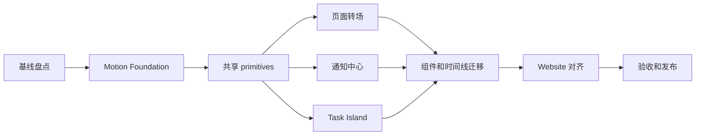

本方案把[动画设计系统](/docs/motion-system/)转成可执行的开发计划。这里的“彻底重构”指重构 CodeY 的 UI 动画层、任务状态呈现和通知编排，不改变守护进程、任务执行、权限协议、事件投影或公共 SDK 的语义。

主要实施对象是 `CodeY/apps/desktop`。`CodeY-Website` 在最后阶段对齐页面转场和文档示例。两边共享设计语义，但各自保留平台实现。

## 当前基线

桌面端已经有一层可复用的基础设施，但参数和职责还没有完全统一：

| 现有位置 | 当前职责 | 重构方向 |
| --- | --- | --- |
| `apps/desktop/src/shared/motion/motion-foundation.tsx` | `MotionConfig`、presence variants、减少动态效果、数字补间 | 作为唯一的 React 动画基础层，改用统一 Motion Token |
| `apps/desktop/src/shared/styles/global.css` | CSS 时长、缓动、dialog、popover、toast、timeline 和状态点动画 | 统一 Token，清理重复 keyframes 和散落的时长 |
| `apps/desktop/src/app/shell/AppShell.tsx` | 页面 presence 转场 | 迁移到页面转场规范，保留焦点和退出时的 inert 语义 |
| `apps/desktop/src/shared/ui/toast.tsx` | Radix Toast、队列、暂停、滑动关闭 | 拆分短通知与持续任务状态，加入事件去重 |
| `apps/desktop/src/shared/ui/status-banner.tsx` 与 `DaemonConnectionBanner.tsx` | 持续的连接或配置状态 | 归入统一 NoticeCenter 的页面级状态条 |
| `apps/desktop/src/features/tasks/TaskProgressCapsule.tsx` | 任务计划和变更摘要的胶囊 | 演进为 Task Island 的一部分 |
| `apps/desktop/src/features/tasks/timeline/timeline-motion.ts` | 时间线内容、状态行和折叠动画 | 使用统一层级和局部变化规则 |

当前 `motion-foundation.tsx` 使用 `enter: 220ms`、`exit: 140ms`、`page: 200ms`、`spring: 300ms`。新规范将页面转场提升到 `480ms`，容器形变使用 `420ms`，因此必须分阶段迁移，不能只替换一组常量。

## 目标架构

```text
daemon snapshot / event projection
              ↓
        task UI state machine
              ↓
     data-state / shared variants
              ↓
 Motion Foundation + CSS Motion Tokens
              ↓
   PageTransition / NoticeCenter / TaskIsland
```

业务状态是唯一输入。动画不创建任务状态，也不改变命令、权限或恢复语义。

四个共享责任边界：

- `PageTransition`：路由和页面层级变化。
- `NoticeCenter`：短通知、页面级状态条、去重和生命周期。
- `TaskIsland`：运行、流式输出、权限、失败、恢复和完成。
- `Motion primitives`：`fade`、`slide`、`scale`、`morph`、`stagger`、`presence`、数字和图标变化。

React 继续使用已有的 `motion/react` 和 Radix primitives。第一阶段不新增动画库，避免同时迁移渲染引擎和设计规范。

## 实施顺序



阶段之间按顺序交付。页面转场和通知中心在共享 primitives 完成后可以并行；Task Island 必须等任务状态映射完成。

## 阶段 0：基线盘点和冻结

### 工作内容

1. 盘点 `apps/desktop/src` 中的 `AnimatePresence`、`motion.*`、`transition`、`animation`、`@keyframes`、`motionDuration` 和所有循环动画。
2. 为每个调用点标记四个动画层级、状态来源、拥有组件和目标 Token。
3. 建立当前行为基线：页面切换、Sheet、toast、连接 banner、任务计划、流式输出、权限、失败、完成、减少动态效果。
4. 保存 Storybook 或 Playwright 的基线截图和短视频。基线只用于对照，不作为新设计的验收结果。
5. 冻结新增局部动画：后续功能只能使用现有基础层，不能继续添加新的 duration、easing 或循环 keyframe。

### 交付物

- 动画调用点清单。
- 状态到组件的映射表。
- 页面、任务和通知的状态矩阵。
- 基线证据和待迁移列表。

### 完成条件

- 每个现有动画都有唯一 owner。
- 没有无法解释的循环动画。
- 任务状态、通知状态和页面状态的边界已经确认。

## 阶段 1：重建 Motion Foundation

### 工作内容

1. 在 `global.css` 增加并统一 `--motion-instant`、`--motion-fast`、`--motion-base`、`--motion-page`、`--motion-morph` 和三个循环 Token。
2. 在 `motion-foundation.tsx` 中导出同一组 TypeScript duration、easing 和 variants。
3. 将 `MotionFoundationProvider` 提升到应用级 provider，移除 TaskProgressCapsule 等组件中的重复 provider。
4. 保留 `reducedMotion="user"`，并让数字补间、滚动、presence 和循环状态都遵守同一判断。
5. 将 `timeline-motion.ts`、`AppShell.tsx`、toast CSS 和 dialog/popover CSS 改为消费 Token。
6. 新增 `MotionState` 类型或等价的状态约束，防止业务组件随意拼接动画状态。

### 交付物

- 单一 Motion Token 层。
- React 和 CSS 两侧一致的 duration、easing 和 reduced-motion 行为。
- Foundation 单元测试和基础 Storybook 场景。

### 完成条件

- 组件中不再出现新的 duration/easing 字面量。
- `motion-foundation.test.ts` 覆盖 reduced motion、数字补间和默认 variants。
- AppShell、Toast 和时间线仍能通过现有 focused tests。

## 阶段 2：共享 Motion primitives

### 工作内容

在 `apps/desktop/src/shared/motion/` 增加最小的共享组件和工具：

- `MotionPresence`：统一进入、退出、`aria-hidden` 和 `inert`。
- `MotionSurface`：popover、dialog、drawer 和 sheet 的容器转场。
- `MotionLayout`：基于 layout/FLIP 的位置连续。
- `MotionNumber`：计时器、计数器和进度数字变化。
- `MotionStatusDot`：idle、running、waiting、failed、completed。
- `motion-variants.ts`：四个层级的 variants 和可复用 transition。

实现规则：

- 组件只接受状态和语义参数，不接受任意 duration。
- 复杂布局使用 `layout` 或 FLIP，避免手工计算每个元素的位移。
- 只有 `transform`、`opacity`、`clip-path` 进入默认动画白名单。
- 所有 primitives 都提供 reduced-motion 分支。

### 完成条件

- primitives 有组件测试、键盘测试和 Storybook 状态场景。
- 无障碍属性在退出期间保持现有语义。
- 现有 Radix Dialog、Popover、Toast 能逐步替换而不改变公共 API。

## 阶段 3：页面转场

### 工作内容

1. 重写 `AppShell` 的 page variants：进入 `480ms`，退出 `400ms`，只使用透明度，页面位移保持为 0。
2. 对路由页面保留稳定的 `key`，避免同一路由因数据刷新重复播放入场。
3. 为详情页、设置页、Market 项目页接入共享元素或 FLIP；没有稳定来源对象的页面使用普通 page transition。
4. 统一 Sheet、drawer、dialog 的层级和遮罩动画。
5. 验证离开页面时焦点、`aria-hidden`、`inert` 和键盘返回路径不被动画打断。

### 完成条件

- 路由切换没有整页闪烁或重复入场。
- 返回、关闭和拖动可以中断并取消。
- 页面转场不改变路由、任务选择或数据加载语义。

## 阶段 4：NoticeCenter

### 工作内容

1. 保留 `shared/ui/toast.tsx` 对 Radix Toast 的封装，但把 `ToastProvider` 的职责收敛为一次性结果通知。
2. 为通知记录增加可选的 `dedupeKey`、来源上下文和持久性级别。
3. 将连接断开、版本更新和需要重新登录的状态交给 `StatusBanner`，不再通过短 toast 承载。
4. 将运行中、等待权限、恢复中和任务失败状态回收到 Task Island 或任务时间线。
5. 保留暂停倒计时、滑动关闭和可访问名称；通知进入 `300ms`，退出 `200ms`，默认停留 `3.5–5s`。
6. 只在确实有新的用户可见结果时发送 toast，避免 error center、banner 和 toast 三重播报。

### 完成条件

- 同一 `dedupeKey` 在短时间内不会生成重复通知。
- 持续状态不会自动消失。
- success、warning、destructive、info 四种语义保留现有本地化和操作按钮。
- toast、banner 和 inline error 的责任边界有测试覆盖。

## 阶段 5：Task Island 和任务状态迁移

### 工作内容

1. 从 daemon projection 和现有任务组件中定义 UI 状态映射：`idle`、`running`、`streaming`、`permission`、`failed`、`completed`。
2. 新建 `TaskIsland`，由它拥有容器尺寸、展开收起、状态点、计时器、摘要和操作区域。
3. 将 `TaskProgressCapsule` 的计划和变更摘要接入 Task Island；保留原有 `onOpenChanges` 和计划查看行为。
4. 将 `PendingPermissionDecision`、`PendingQuestionForm`、`PendingPublications`、`PendingOfficeRecoveries` 等待状态接入同一容器的 details region。
5. 将停止、允许、拒绝、重试、恢复和打开详情保持为原有命令调用，不在 UI 动画层新增命令。
6. 任务完成时执行“结果出现 → 勾选 → 收回容器”的顺序；任务失败时保留原因和修复操作。
7. 流式输出按块更新，不逐字播放；循环状态只在对应 daemon state 存在时运行。

### 完成条件

- 所有任务状态都有唯一呈现位置。
- 状态迁移不会重复发送命令或改变 daemon 事件投影。
- 权限和问题等待不会被短 toast 覆盖或自动消失。
- 任务重连、重启恢复和切换任务时，Task Island 能从快照重新得到正确状态。
- Task Island 的 Storybook 和 `TaskWorkspace` 测试覆盖完整状态矩阵。

## 阶段 6：组件、时间线和循环动画迁移

### 工作内容

按调用点清单逐批迁移：

1. `timeline-motion.ts`：消息块、状态行、折叠和定位高亮。
2. `ComposerAddPanel`、`ComposerSuggestionPanel`、`SlashCommandMenu`、`ReferenceCombobox`：popover、建议列表和 presence。
3. Tabs、accordion、tooltip、checkbox、select、dropdown 等 `shared/ui` primitives。
4. Sidebar、Marketplace、Settings、video workspace 和其他 feature 内的局部入场动画。
5. 状态点、spinner、shimmer、光标和完成勾选：逐一确认 owner、周期和停止条件。
6. 列表新增、删除、排序和筛选：使用局部 presence 或 FLIP，不重播整页动画。

### 完成条件

- 业务组件不再直接依赖旧的 `MOTION_EASE_*` 或自定义 duration。
- 所有循环动画都绑定到明确状态并在状态结束时停止。
- 同一类控件在不同 feature 使用同一 motion primitive。

## 阶段 7：Website 对齐

### 工作内容

1. 在 `CodeY-Website/src/styles/tokens.css` 增加与桌面端语义一致的 Motion Token。
2. 在 Astro 布局接入 View Transitions，统一营销页、Market、Console 和文档页的页面转场。
3. 将网站 toast、表单成功状态、Market 卡片详情和原型中的 `.dock` 映射到同一套状态规则。
4. 适配 `prefers-reduced-motion`，并保持中英文页面结构和文案镜像。
5. 更新设计文档中的实现链接和示例。

### 完成条件

- Website 不再出现与设计系统冲突的独立 duration 或 easing。
- 中文和英文构建通过，页面转场不破坏静态路由和表单状态。
- 文档、原型和实际组件使用同一组名称：PageTransition、NoticeCenter、TaskIsland、Motion primitives。

## 测试和验收

### 单元和组件测试

- `motion-foundation.test.ts`：Token、reduced motion、数字补间和 variants。
- `toast.test.tsx`：去重、队列、暂停、滑动关闭、动作按钮和退出清理。
- `TaskProgressCapsule.test.tsx` 与 `TaskWorkspace` 测试：状态映射、展开、权限、失败、完成和重连。
- primitives 测试：presence、焦点、`aria-hidden`、`inert` 和取消。

### 视觉和交互测试

为以下场景建立 Storybook 或 Playwright 场景：

- 页面进入、返回、Sheet 拖动取消和完成。
- success、warning、destructive、info 通知。
- Task Island 六种状态和所有主要迁移。
- 流式输出、长任务、网络断开、恢复和完成。
- 深色、浅色、窄窗口、键盘操作和 `prefers-reduced-motion`。

### 性能验收

- 常见状态变化不产生持续主线程长任务。
- 默认动画优先使用合成层属性。
- 长列表不因逐项入场造成明显布局抖动。
- 关闭 reduced motion 后不再运行状态循环动画。

### 回归验收

- 任务创建、停止、权限决定、问题回答、重试、恢复和重连的命令参数完全不变。
- daemon snapshot、event projection、task selection 和 scroll ownership 测试不回归。
- `pnpm -C apps/desktop typecheck`、`pnpm -C apps/desktop lint`、受影响 Vitest、Storybook 场景和 Website `pnpm check` 通过。

## 发布和回滚

每个阶段单独提交，提交顺序固定为：

```text
chore: inventory desktop motion call sites
feat: rebuild motion foundation tokens
feat: add shared motion primitives
feat: migrate page transitions
feat: centralize notification motion
feat: introduce task island states
refactor: migrate feature motion call sites
feat: align website motion tokens
test: add motion acceptance coverage
```

阶段 3 到阶段 6 使用一个桌面端内部开关或可逆 provider 入口进行渐进切换。开关只选择旧 variants 或新 variants，不复制业务状态。发现命令、权限或恢复语义异常时，回退到上一阶段提交即可；不回滚 daemon 或协议代码。

## 风险和应对

| 风险 | 应对 |
| --- | --- |
| 页面转场与组件入场叠加 | 阶段 0 为每个调用点指定唯一 owner；页面层只负责页面边界 |
| Task Island 覆盖任务操作 | 先复用现有 command handlers，再替换呈现容器 |
| 持久状态被误做成 toast | NoticeCenter 只承载一次性结果，任务状态由任务 surface 拥有 |
| reduced motion 漏处理 | Foundation 统一降级，组件测试强制覆盖 |
| 迁移期间新旧 Token 并存 | 增加 motion-token 检查，禁止新增散落 duration/easing |
| 视觉调整改变布局语义 | 每阶段保留交互测试，视觉改动不能改变选择、滚动和焦点所有权 |

## 最终完成定义

重构完成时，CodeY 应满足：

- 页面、通知、Task Island 和控件反馈使用同一套 Motion Token。
- 所有持续动画都绑定到明确的任务或 UI 状态。
- 任务状态只由 daemon projection 驱动，动画不拥有业务状态。
- 页面转场、通知和容器形变可以中断、取消和恢复。
- reduced motion 下信息和操作仍然可理解。
- Desktop 和 Website 的文档、Token 名称和状态语义保持一致。
