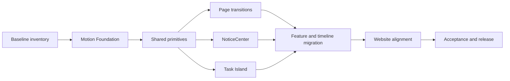

This plan turns the [motion design system](/en/docs/motion-system/) into an executable development plan. “Complete refactor” means refactoring CodeY's UI motion layer, task-state presentation, and notification orchestration. It does not change the daemon, task execution, permission protocol, event projection, or public SDK semantics.

The primary implementation target is `CodeY/apps/desktop`. `CodeY-Website` aligns page transitions and documentation examples in the final phase. Both surfaces share motion semantics while retaining platform-specific implementations.

## Current baseline

The desktop app already has reusable infrastructure, but its values and ownership are not fully unified:

| Existing location | Current responsibility | Refactor direction |
| --- | --- | --- |
| `apps/desktop/src/shared/motion/motion-foundation.tsx` | `MotionConfig`, presence variants, reduced motion, and number tweening | Keep as the only React motion foundation and migrate it to shared Motion Tokens |
| `apps/desktop/src/shared/styles/global.css` | CSS durations, easings, dialog, popover, toast, timeline, and status-dot motion | Unify tokens and remove duplicate keyframes and scattered durations |
| `apps/desktop/src/app/shell/AppShell.tsx` | Page presence transition | Migrate to the page transition spec while preserving focus and inert semantics |
| `apps/desktop/src/shared/ui/toast.tsx` | Radix Toast, queue, pause, and swipe dismissal | Separate short notices from persistent task state and add event deduplication |
| `apps/desktop/src/shared/ui/status-banner.tsx` and `DaemonConnectionBanner.tsx` | Persistent connection or configuration state | Move into the NoticeCenter page-level status role |
| `apps/desktop/src/features/tasks/TaskProgressCapsule.tsx` | Task plan and change summary capsule | Evolve into part of Task Island |
| `apps/desktop/src/features/tasks/timeline/timeline-motion.ts` | Timeline content, status rows, and disclosure motion | Apply the shared layer and local-change rules |

The current foundation uses `enter: 220ms`, `exit: 140ms`, `page: 200ms`, and `spring: 300ms`. The new system uses `480ms` for page transitions and `420ms` for container morphs, so this must be migrated in phases rather than by replacing one constant.

## Target architecture

```text
daemon snapshot / event projection
              ↓
        task UI state machine
              ↓
     data-state / shared variants
              ↓
 Motion Foundation + CSS Motion Tokens
              ↓
   PageTransition / NoticeCenter / TaskIsland
```

Business state is the only input. Motion does not create task state or change command, permission, or recovery semantics.

The four shared ownership boundaries are:

- `PageTransition`: route and page hierarchy changes.
- `NoticeCenter`: short notices, page-level status bars, deduplication, and lifecycle.
- `TaskIsland`: running, streaming, permission, failure, recovery, and completion.
- `Motion primitives`: `fade`, `slide`, `scale`, `morph`, `stagger`, `presence`, number changes, and icon changes.

React continues to use the existing `motion/react` and Radix primitives. The first phase adds no motion library so that the rendering engine and design system are not migrated at the same time.

## Implementation order



Phases ship in order. Page transitions and NoticeCenter may run in parallel after shared primitives are complete. Task Island waits for the task-state mapping.

## Phase 0: baseline inventory and freeze

### Work

1. Inventory `AnimatePresence`, `motion.*`, `transition`, `animation`, `@keyframes`, `motionDuration`, and all loops under `apps/desktop/src`.
2. Assign every call site to one motion layer, state source, owner, and target Token.
3. Capture baselines for route changes, sheets, toasts, connection banners, task plans, streaming, permissions, failure, completion, and reduced motion.
4. Save Storybook or Playwright screenshots and short videos. Baselines are references, not acceptance results for the new design.
5. Freeze new local motion. New features may use the existing foundation but may not add duration, easing, or loop keyframes.

### Deliverables

- Motion call-site inventory.
- State-to-component map.
- Page, task, and notice state matrix.
- Baseline evidence and migration list.

### Exit criteria

- Every existing animation has one owner.
- No loop lacks an understandable state.
- The boundaries between task state, notice state, and page state are agreed.

## Phase 1: rebuild Motion Foundation

### Work

1. Add and unify `--motion-instant`, `--motion-fast`, `--motion-base`, `--motion-page`, `--motion-morph`, and the three loop Tokens in `global.css`.
2. Export the same durations, easings, and variants from `motion-foundation.tsx`.
3. Promote `MotionFoundationProvider` to the app provider and remove duplicate providers inside components such as `TaskProgressCapsule`.
4. Keep `reducedMotion="user"` and make number tweening, scrolling, presence, and loops use the same decision.
5. Migrate `timeline-motion.ts`, `AppShell.tsx`, toast CSS, and dialog/popover CSS to the Tokens.
6. Add a `MotionState` type or equivalent constraint so feature components cannot invent arbitrary animation states.

### Deliverables

- A single Motion Token layer.
- Matching duration, easing, and reduced-motion behavior in React and CSS.
- Foundation unit tests and baseline Storybook stories.

### Exit criteria

- Components contain no new duration or easing literals.
- `motion-foundation.test.ts` covers reduced motion, number tweening, and default variants.
- AppShell, Toast, and timeline focused tests still pass.

## Phase 2: shared motion primitives

### Work

Add the smallest shared components and utilities under `apps/desktop/src/shared/motion/`:

- `MotionPresence`: shared enter, exit, `aria-hidden`, and `inert` behavior.
- `MotionSurface`: popover, dialog, drawer, and sheet transitions.
- `MotionLayout`: layout/FLIP position continuity.
- `MotionNumber`: timer, counter, and progress changes.
- `MotionStatusDot`: idle, running, waiting, failed, and completed.
- `motion-variants.ts`: variants and transitions for the four motion layers.

Rules:

- Components accept state and semantic options, not arbitrary durations.
- Use `layout` or FLIP for complex layouts instead of hand-calculated offsets.
- The default animation whitelist is `transform`, `opacity`, and `clip-path`.
- Every primitive provides a reduced-motion branch.

### Exit criteria

- Primitives have component, keyboard, and Storybook state coverage.
- Accessibility attributes preserve their semantics while a component exits.
- Existing Radix Dialog, Popover, and Toast APIs can be migrated incrementally.

## Phase 3: page transitions

### Work

1. Rewrite `AppShell` page variants: `480ms` enter, `400ms` exit, using opacity only with zero page offset.
2. Keep stable route keys so a data refresh does not replay a page entrance.
3. Add shared elements or FLIP to detail pages, settings, Market items, and model views. Pages without a stable source object use the standard page transition.
4. Unify sheet, drawer, dialog, and scrim layers.
5. Verify focus, `aria-hidden`, `inert`, and keyboard back paths while leaving a page.

### Exit criteria

- Route changes have no full-page flash or duplicate entrance.
- Back, dismiss, and drag actions can be interrupted and cancelled.
- Transitions do not change route, task selection, or data-loading semantics.

## Phase 4: NoticeCenter

### Work

1. Keep the Radix wrapper in `shared/ui/toast.tsx`, but limit `ToastProvider` to one-shot result notices.
2. Add optional `dedupeKey`, source context, and persistence level to notice records.
3. Move connection loss, updates, and sign-in requirements to `StatusBanner` instead of short toasts.
4. Move running, permission, recovery, and task-failure states into Task Island or the task timeline.
5. Keep pause, swipe dismissal, and accessible labels; use `300ms` enter, `200ms` exit, and `3.5–5s` default dwell.
6. Emit a toast only for a new user-visible result, avoiding triple announcements from the error center, banner, and toast.

### Exit criteria

- One `dedupeKey` cannot create repeated short notices within the dedupe window.
- Persistent state does not disappear automatically.
- The existing localized success, warning, destructive, and info semantics and actions remain available.
- Toast, banner, and inline-error ownership has test coverage.

## Phase 5: Task Island and task-state migration

### Work

1. Define the UI mapping from daemon projection and current task components: `idle`, `running`, `streaming`, `permission`, `failed`, and `completed`.
2. Create `TaskIsland` as the owner of container size, expansion, status dot, timer, summary, and actions.
3. Connect `TaskProgressCapsule` plan and change summary to Task Island while preserving `onOpenChanges` and plan-view behavior.
4. Connect `PendingPermissionDecision`, `PendingQuestionForm`, `PendingPublications`, and `PendingOfficeRecoveries` to the same details region.
5. Keep stop, allow, deny, retry, recovery, and detail actions on their existing command handlers. The motion layer adds no commands.
6. On completion, show result, draw the checkmark, then collapse. On failure, keep the cause and repair action visible.
7. Update streamed output in chunks, not character by character. Run loops only while the corresponding daemon state exists.

### Exit criteria

- Every task state has one presentation owner.
- State changes do not resend commands or alter daemon event projection.
- Permission and question states cannot be hidden by a short toast or disappear automatically.
- Reconnect, restart recovery, and task switching reconstruct Task Island from the snapshot.
- Task Island stories and `TaskWorkspace` tests cover the full state matrix.

## Phase 6: component, timeline, and loop migration

Migrate call sites in batches:

1. `timeline-motion.ts`: message blocks, status rows, disclosure, and locate highlight.
2. `ComposerAddPanel`, `ComposerSuggestionPanel`, `SlashCommandMenu`, and `ReferenceCombobox`: popover, suggestion, and presence motion.
3. Tabs, accordion, tooltip, checkbox, select, and dropdown primitives in `shared/ui`.
4. Sidebar, Marketplace, Settings, video workspace, and other feature-local entrances.
5. Status dot, spinner, shimmer, cursor, and completion check: confirm owner, period, and stop condition for each.
6. List insert, removal, sorting, and filtering: use local presence or FLIP instead of replaying the full-page entrance.

### Exit criteria

- Feature components no longer depend on legacy `MOTION_EASE_*` or custom duration literals.
- Every loop is bound to a state and stops when the state ends.
- The same class of control uses the same motion primitive across features.

## Phase 7: Website alignment

### Work

1. Add Motion Tokens with matching semantics to `CodeY-Website/src/styles/tokens.css`.
2. Add View Transitions to the Astro layout and align marketing, Market, Console, and docs page transitions.
3. Map website toasts, form success states, Market detail cards, and the prototype `.dock` to the same state rules.
4. Support `prefers-reduced-motion` and preserve Chinese/English page parity.
5. Update the design document's implementation links and examples.

### Exit criteria

- The Website has no independent duration or easing that conflicts with the motion system.
- Chinese and English builds pass, and transitions do not break static routes or form state.
- Documentation, prototype, and implementation use the same names: PageTransition, NoticeCenter, TaskIsland, and Motion primitives.

## Testing and acceptance

### Unit and component tests

- `motion-foundation.test.ts`: Tokens, reduced motion, number tweening, and variants.
- `toast.test.tsx`: dedupe, queue, pause, swipe dismissal, action buttons, and exit cleanup.
- `TaskProgressCapsule.test.tsx` and `TaskWorkspace` tests: state mapping, expansion, permission, failure, completion, and reconnect.
- Primitive tests: presence, focus, `aria-hidden`, `inert`, and cancellation.

### Visual and interaction tests

Create Storybook or Playwright scenarios for:

- Page enter, back, sheet drag cancellation, and completion.
- Success, warning, destructive, and info notices.
- All six Task Island states and primary migrations.
- Streaming, long tasks, disconnect, recovery, and completion.
- Dark, light, narrow windows, keyboard use, and `prefers-reduced-motion`.

### Performance acceptance

- Common state changes do not create sustained long main-thread tasks.
- Default motion uses compositor-friendly properties.
- Long lists do not visibly shake because of per-row entrances.
- Reduced motion stops state loops.

### Regression acceptance

- Task creation, stop, permission decisions, questions, retry, recovery, and reconnect keep exactly the same command parameters.
- Daemon snapshots, event projections, task selection, and scroll ownership tests do not regress.
- `pnpm -C apps/desktop typecheck`, `pnpm -C apps/desktop lint`, affected Vitest tests, Storybook scenarios, and Website `pnpm check` pass.

## Release and rollback

Ship each phase as a separate commit in this order:

```text
chore: inventory desktop motion call sites
feat: rebuild motion foundation tokens
feat: add shared motion primitives
feat: migrate page transitions
feat: centralize notification motion
feat: introduce task island states
refactor: migrate feature motion call sites
feat: align website motion tokens
test: add motion acceptance coverage
```

Phases 3 through 6 use an internal desktop switch or reversible provider entry for gradual adoption. The switch selects legacy or new variants; it does not duplicate business state. If command, permission, or recovery semantics regress, revert the last phase commit. Do not roll back daemon or protocol code.

## Risks and responses

| Risk | Response |
| --- | --- |
| Page and component entrances overlap | Assign one owner per call site in Phase 0; the page layer owns only page boundaries |
| Task Island covers task actions | Reuse existing command handlers before replacing the presentation container |
| Persistent state becomes a toast | NoticeCenter owns one-shot results; the task surface owns task state |
| Reduced motion is missed | Centralize the downgrade in Foundation and require component coverage |
| Old and new Tokens coexist | Add a motion-token check that rejects new scattered duration/easing values |
| Visual tuning changes layout semantics | Keep interaction tests in every phase; visual motion cannot change focus, selection, or scroll ownership |

## Definition of done

The refactor is complete when:

- Pages, notices, Task Island, and control feedback use the same Motion Tokens.
- Every loop is bound to an explicit task or UI state.
- Task state is driven only by daemon projection; motion does not own business state.
- Page transitions, notices, and container morphs can be interrupted, cancelled, and resumed.
- State and actions remain understandable with reduced motion.
- Desktop and Website documentation, Token names, and state semantics remain aligned.
